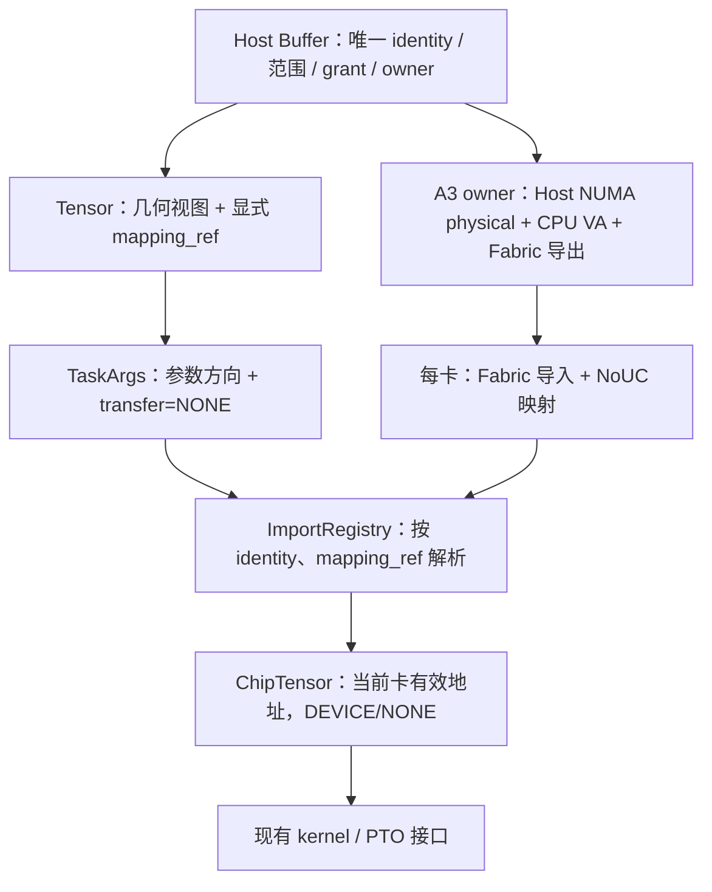
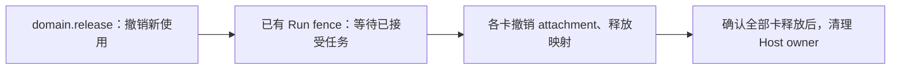
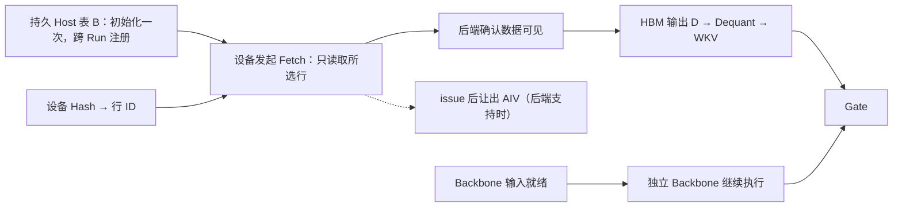

# A3 单机多卡 Host 通信域

本实现把一块 Host DRAM 加入现有 L3 CommDomain：各卡显式选择自己的映射，仍用普通 Tensor 参数进入 kernel。Host 不占通信 rank。A5、多机和自动传输选路不属于本次范围。

## 使用方式

```python
domain = orch.get_or_allocate_domain(
    name="host-table", members=[0, 1], window_size=65536,
    buffers=[CommBufferSpec("output", "float32", 16384, 65536)],
    host_window=HostWindowSpec(nbytes=65536, numa_id=0),
    retain_after_run=True,
)
orch.copy_to_domain(domain, None, data)  # None 选择本机 Host backing
native = domain.host().tensor((16384,), DataType.FLOAT32)
mapped = domain.map_view(native, domain_rank=0)
args = TaskArgs()
args.add_tensor(mapped, TensorArgType.INPUT, transfer=TensorTransfer.NONE)
# 后续沿用 orch.submit_next_level(..., worker=0)。
# worker 参数使用 members 中对应的实际 worker 编号；本例 rank 0 对应 worker 0。
```

`copy_to_domain` / `copy_from_domain` 是同步的编排阶段操作，必须先于当前 Run 的任务提交；它们不会等待已经排队的任务。应在 Run 完成后通过后续 Run 读取输出。CPU 原生访问目前仅支持创建域的 endpoint，不支持把该 Host 引用发给 Python 子任务。

## 公共契约与平台实现

### 前后端边界（实现约束）

以下是 A3/A5 共用的契约，不应因为更换传输引擎而重新实现：

- **Buffer**：canonical identity、物理位置、范围、grant、owner 与跨 Run 保留。
- **Tensor / TaskArgs**：显式消费视图、几何范围、参数方向和每参数 transfer；不携带异进程裸指针。
- **domain / ImportRegistry**：成员与 endpoint 授权、消费端解析、旧引用失效；复用既有登记和解析路径。
- **Run / completion 生命周期**：接受使用后保留资源，真实完成前不放行消费者、不复用输出；关闭先撤销新使用。

平台后端负责内存分配约束、注册/映射、设备可用地址或通信 context、提交与完成适配，以及逆序释放。A3 当前使用 Host NUMA physical/Fabric/NoUC，数据搬运复用已有 MTE 或 PTO SDMA 路径；A5 后续可以实现本地 ACL/MTE 或跨 rank URMA。

`HostDomainResource` 只保留资源身份、view 校验、使用保留和清理责任；`host_domain_backend.py` 提供 A3 与模拟 backing 的创建/释放实现，消费侧由平台 `comm_attach_domain_host` 建立映射。A5 尚未实现，不会落入 A3 默认分支；接入时不复制 domain/registry/runner。

`map_view` 当前只承诺已经建立的直接地址映射。URMA 需要的注册、channel、远端信息与 completion context 不是普通映射地址，不能为了共用 API 就虚构 DIRECT_LOAD/STORE 能力。后续接入应扩展既有通信 context 和 completion 后端，继续使用同一 Buffer identity 与调用约定；本地 MTE 和远端 fetch 的能力需分别验证。

公共 API 不应要求业务代码写 A3/A5 专用资源管理分支。kernel 仍决定是否读取、读取哪些行；平台能力决定可用的传输实现。当前测试显式选择 MTE/SDMA 是覆盖两条实际路径，并不表示已经实现自动选路或回退策略。



- Buffer 始终是 HOST，同一 backing 的原生与映射 Tensor 共用 identity、范围和 grant。没有 `device_readable` 开关，也不把某个设备地址写回 Buffer。
- 映射由 backend 成功后登记；Tensor 中的选择值不能凭空授予权限。提交校验实际目标卡、完整描述符和域存活状态，消费端再次解析。
- 当前一域一块 Host backing，映射在域生命周期内固定。释放再创建会获得新 identity，因此旧 Tensor 不能绑定到同名新域。暂不提供独立 unmap/remap 或 context 原位重建。
- 本地 Tensor 仍为 144 B；byte 141 保留参数 transfer，byte 142 保存 mapping_ref。零表示原生视图。所有进程必须使用同版 Python/native 构建；不支持混用旧、新 binary。跨机器 wire 明确拒绝 endpoint-local mapping_ref。

## 传输与完成

资源准备只建立可访问性，不代表输入已经就绪。调用方选择现有 kernel；本次不新增按平台拆分的 Host 前端，也不增加自定义 SDMA engine。

- MTE kernel 通过现有 PTO load/store 消费映射地址，沿用任务完成语义。
- A3 异步 SDMA 沿用 `get_dma_workspace → SdmaTget → send_request_entry`，实际发起复用 PTO `TGET_ASYNC`。现有 completion manager 确认传输完成后，scheduler 才能放行依赖输出的消费者。
- 映射选择不决定同步/异步；完成机制属于传输和运行时。测试同时覆盖 Host→HBM 与 HBM→Host，SDMA 后接真实消费者验证可见性。

## 关闭顺序



复用现有 domain accepted-use 和清理 journal。任一卡释放未确认，保留 Host owner；卡端释放已经成功而 Host 清理失败时，仅重试 owner 清理，不重放 collective release。Worker.close 仍负责处理未完成的清理责任。

## 验证入口

- `tests/ut/py/test_host_domain.py`：双卡建域、view 目标校验、跨 Run、旧引用、配置冲突和 owner 清理失败重试。
- `tests/ut/py/test_buffer.py`：同 identity 的原生/映射参数共存、grant 与失效校验。
- `tests/st/worker/comm_domain/test_host_domain.py`：两卡 MTE 读写、PTO SDMA producer→consumer、BF16 设备选行，以及任务提交后的域释放；SDMA 必须在 A3 真机执行。

2026-10-29 在 A3、CANN 9.0.0、`tensormap_and_ringbuffer` 上完成双卡验证：上述六项全部通过，MTE/SDMA 两个方向均跨两轮 Run 复用 backing。公共 Python 回归 375 项通过、2 项跳过，C++ Buffer/RemoteWire 共 39 项通过。未进行全仓测试；这些结果不代表 A2/A5、其他 runtime 或通信计算重叠的验收。

## 对齐 #2657 的业务场景

[Issue #2657](https://github.com/hw-native-sys/simpler/issues/2657) 的目标是持久 Host 表上的设备发起异步稀疏 fetch。当前 A3 域实现提供资源与映射基础，尚不能以整段拷贝测试宣称完成该 issue。其当前 PR1/PR2 划分面向 A5：PR1 是同进程同步 MTE，PR2 必须包含同机跨进程/跨 rank URMA；每卡分别映射后本地 MTE 读取不能替代 PR2。



实线表示数据依赖；虚线表示 issue 后的资源处理。Backbone 不依赖 Hash/fetch，应在自身输入就绪后独立推进。

需要按实际数据路径补齐以下验收，不把模型算法写进公共 scheduler：

1. 设备生成/持有 row IDs，读取重复 ID、首尾行和越界情况；输出由调用方提供。A3 多卡读取同一 Host backing 作为当前阶段用例，不能代替 A5 跨 rank URMA 或多机验收。
2. 表只初始化、注册一次，后续 Run 只读取所选行；设备存储不随整表大小增长。除整段 FP32 MTE/SDMA 测试外，`test_device_selected_bf16_rows` 使用设备侧 ID 选择 BF16 payload 行（逐位比较），并将非法 ID 定义为零行；两轮复用同一 backing，第二轮更新源数据以验证可见性。该用例已通过 A3 双卡真机验证，不覆盖 MXFP8/dequant；后者随对应业务路径验证。
3. 分开记录 issue kernel 返回和真实传输完成。延迟完成时 Dequant/WKV 不能提前运行，独立 Backbone 可继续推进；若等待占住必需 AIV，应明确限制，不能仅凭 token 宣称隐藏延迟。
4. 两次 fetch 交错：请求/completion 槽只在后端确认不再引用后退休，输出 D 必须保留到其最后消费者结束。第二次 fetch 不能覆盖第一次仍被消费的输出。
5. trace 观察请求发出、数据可见、独立计算与消费者开始；在途期间有用计算推进是 issue 验收要求。相同工作量串行对照、剩余等待、总耗时与 Backbone 是否变慢是本项目补充的性能验收建议，不是 issue 规定的固定加速比。

Hcomm/ElasticBuffer、PTO URMA 与 simpler completion 只复用已确认兼容的边界；不得假定 handle、CQ 布局或完成通知可以直接互换。若接外部 stream 算子，仍需分别接通输入就绪、传输完成和输出保留。

A5 后端可参考 [#2714 的单卡 Host URMA 资格验证](https://github.com/hw-native-sys/simpler/pull/2714#issuecomment-6491020508)：同卡不同 EID、Host 控制面 UBC_TP、AIV ReadNbi/BatchCommit 与后续 Drain。该证据推翻“同进程 Host 只能同步读”的假设；尚不证明 simpler runtime 集成、计算重叠或多卡能力。Hcomm 的注册类型描述设备可见地址，源 backing 仍应保持 HOST。
